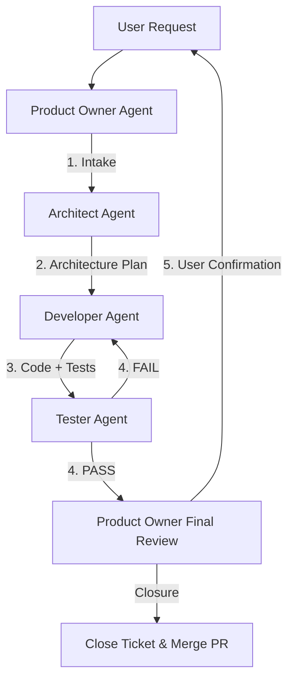
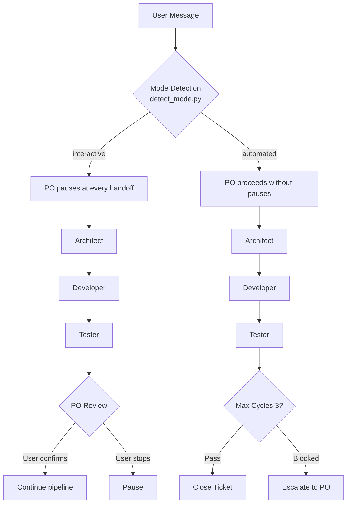

# opencode Agent Team — Complete Team Configuration

This directory contains the agent team discovered by opencode,
comprising specialized agents that collaborate to deliver high-quality
features through a structured, repeatable workflow.

All Agent Dev Team documentation is located in this `.opencode/agents/` folder:

```
AGENTS.md                  ← Top-level guide: project conventions, modes, CI gates (README.md)
└── .opencode/docs/WORKFLOW.md ← This file: agent team workflow, diagrams, quality gates
    ├── ARCHITECTURE.md      ← Agent Team architecture and design principles
    ├── REQUIREMENTS.md      ← Agent Dev Team functional and quality requirements
    ├── product-owner.agent.md ← Product Owner Agent (YAML config + detailed documentation)
    ├── architect.agent.md     ← Architect Agent (YAML config + detailed documentation)
    ├── developer.agent.md     ← Developer Agent (YAML config + detailed documentation)
    ├── tester.agent.md        ← Tester & Validator Agent (YAML config + detailed documentation)
    ├── complete-feature/SKILL.md ← Feature completion, AC validation, JIRA closure
    ├── develop-feature/SKILL.md    ← Feature implementation workflow, implementation steps
    ├── discover-feature/SKILL.md   ← Feature discovery, JIRA ticket creation, story points, ACs
    ├── orchestrate-feature/SKILL.md← Pipeline orchestration, dispatch, escalation, handoff tracking
    ├── refine-feature/SKILL.md     ← Stakeholder review, ticket finalization
    └── release-project/SKILL.md    ← Release process, versioning, GitHub Release, JIRA version
```

## Triggering Workflows

### User Messages / Commands

| Intent | User Message | Triggered By |
|--------|-------------|--------------|
| **Plan a feature** | `plan a feature`, `create a new ticket`, `estimate effort`, `discovery session` | PO: `discover-feature` skill |
| **Refine a feature** | `refine the backlog`, `stakeholder review`, `review the ticket`, `finalize the ticket` | PO: `refine-feature` skill |
| **Define AC** | `define AC/acceptance criteria for PRO-XXX` | PO: `discover-feature` skill |
| **Start development** | `start development on PRO-XXX`, `start feature PRO-XXX`, `implement PRO-XXX` | PO: `develop-feature` skill (entry gate) |
| **Implement** | (post-dispatch) developer receives architecture plan | Developer: `develop-feature` skill |
| **Test/Validate** | `test PRO-XXX`, `validate implementation` | Tester: `complete-feature` skill |
| **Complete feature** | `complete feature PRO-XXX`, `finalise implementation` | PO: `complete-feature` skill |
| **Release** | `release`, `create a release`, `tag vX.Y.Z`, `publish release notes` | PO: `release-project` skill |
| **Contract review** | `review contracts`, `update contracts PRO-XXX` | Architect: contract review pass |
| **Unit tests** | `run unit tests`, `unit test PRO-XXX` | Developer: `pytest` / `run_tests.sh` |
| **Set dev mode** | `run in automated` / `run in interactive` / `proceed` / `pause` | PO: `detect_mode.py` |
| **Pipeline control** | `python .opencode/scripts/pipeline.py <cmd> <ticket>` | User/PO |

### Message to Skill Bindings (opencode)

| Message pattern | Skill launched |
|-----------------|----------------|
| `plan a feature`, `plan <feature>` | `discover-feature` (workflow: discover-feature) |
| `refine-feature`, `refine the backlog`, `stakeholder review` | `refine-feature` |
| `develop-feature`, `develop feature PRO-XXX`, ticket link → `develop-feature` | `develop-feature` |
| `complete-feature`, `complete feature PRO-XXX` | `complete-feature` |
| `orchestrate-feature`, `run the pipeline` | `orchestrate-feature` (dispatches to PO/Arch/Dev/Tester) |
| `release-project`, `release`, `tag`, `publish release notes` | `release-project` |

### Lifecycle Chart

```
User message "plan a feature"
        │
        ▼
┌─────────────────┐     JIRA drafted     ┌──────────────────────┐
│  discover-feature│ ───────────────────▶│ JIRA Story (PRO-XXX) │
│  (PO)           │                       └──────────┬───────────┘
└─────────────────┘                                  │
                                                      │ review + finalize
                                                      ▼
                                         ┌──────────────────────────┐
                                         │  refine-feature          │
                                         │  (PO + stakeholders)     │
                                         └──────────┬───────────────┘
                                                    │
                                                    ▼
                                        ┌──────────────────────────┐
                                        │  Story points assigned   │
                                        │  before sprint pickup    │
                                        └──────────┬───────────────┘
                                                   │
    "proceed" / PO dispatch                       │
   ┌──────────────────────────────────────────────┘
   ▼
┌─────────────────┐                    ┌─────────▼──────────┐
│ develop-feature │                    │ orchestrate-feature│
│ (Dev)           │ ◀── architecture ──│ dispatches         │
│                 │     plan           │ Architect → Dev    │
└────────┬────────┘                    └─────────┬──────────┘
         │ ACs + impl plan                       │
         ▼                                       ▼
┌─────────────────┐                    ┌──────────────────────┐
│ complete-feature│                    │ complete-feature     │
│ (Tester)        │                    │ (PO closure)         │
└────────┬────────┘                    └──────────────────────┘
         │ validated + ACs checked
         ▼
┌─────────────────┐
│ release-project │  tag vX.Y.Z → PR merge → JIRA release
└─────────────────┘
```

## Pipeline Commands (orchestration)

The pipeline is driven from a shell via `.opencode/scripts/pipeline.py`:

```bash
# Show current state of a ticket (mode, step, cycle counts, status, escalation)
python .opencode/scripts/pipeline.py show state PRO-373

# Show what work was missed in an interrupted pipeline
python .opencode/scripts/pipeline.py what-missed PRO-373

# Resume the pipeline at its current step (clears interruption flag)
python .opencode/scripts/pipeline.py resume PRO-373

# Advance to the next pipeline step
python .opencode/scripts/pipeline.py continue PRO-373

# (Re)proceed with current step execution
python .opencode/scripts/pipeline.py proceed PRO-373

# Detect and alert on stuck pipelines
python .opencode/scripts/pipeline.py check-stuck PRO-373

# Preview an action without executing (dry-run)
python .opencode/scripts/pipeline.py dry-run PRO-373 <action>

# Show pipeline history
python .opencode/scripts/pipeline.py history PRO-373

# Reset all cycles and state for a ticket
python .opencode/scripts/pipeline.py reset PRO-373

# Set / show the development mode for a ticket
python .opencode/scripts/pipeline.py set-mode PRO-373 automated   # or: interactive
python .opencode/scripts/pipeline.py get-mode PRO-373
```

### Orchestration dispatch (orchestrate-feature)

The `orchestrate-feature` skill reads JIRA state, tracks cycles, and dispatches work
to the Architect → Developer → Tester pipeline, handling escalations and handoffs:

| Step | Stage | Gate / Input | Output |
|------|-------|--------------|--------|
| 1 | Architecture review | User stories + ACs vs `ARCHITECTURE.md` | Approved implementation plan |
| 2 | Developer implementation | Approved plan | Feature branch with changes |
| 3 | Tester validation | Implementation + ACs | Validation result, AC status |
| 4 | PO completion | Validation report | ACs checkmarked, DoD done, feature closure |

```text
PO ──dispatch──▶ Architect ──plan──▶ Developer ──impl──▶ Tester ──validate──▶ PO ──PR/JIRA──▶ Done
```

### Handoff Labels (agent-to-agent)

| From → To | Handoff Label | Message |
|-----------|--------------|---------|
| PO → Architect | `Request Architecture Review` | Review user stories + ACs against ARCHITECTURE.md |
| Architect → Developer | `Start Implementation` | Approved implementation plan with phases/files |
| Developer → Tester | `Start Testing & Validation` | Implementation output + acceptance criteria |
| Tester → Developer | `Request Fixes` | Issues with severity, evidence, root causes |
| Tester → PO | `Approve & Complete` | Validation result, AC status, test summary |
| PO → User | `Final Review` | Complete summary, AC status, PR status |

## Visual Representation

### Agent Development Workflow



### Interactive vs Automated Mode Decision



## Agent Team Overview

| Agent | Role | Input | Output | Handoff To |
|-------|------|-------|--------|-----------|
| **Product Owner** | Transform user intent into testable requirements | User request, feature ideas | User Stories with acceptance criteria | Architect |
| **Architect** | Translate requirements into technical plans | User Stories, acceptance criteria | Implementation plan with phases and files | Developer |
| **Developer** | Implement features following the plan | Implementation plan, architecture | Code changes, tests, commits | Tester |
| **Tester** | Validate correctness and quality | Implementation, tests, requirements | Pass/Fail decision with evidence | Product Owner / Developer |

## File Structure

This directory contains the opencode-discovered agent team and skills:

```
.opencode/
├── agents/          # Agent definitions discovered by opencode
│   ├── architect.agent.md
│   ├── developer.agent.md
│   ├── product-owner.agent.md
│   └── tester.agent.md
├── skills/          # Workflow reference documents discovered by opencode
│   ├── complete-feature/SKILL.md
│   ├── develop-feature/SKILL.md
│   ├── discover-feature/SKILL.md
│   ├── orchestrate-feature/SKILL.md
│   ├── refine-feature/SKILL.md
│   └── release-project/SKILL.md
└── scripts/         # Pipeline automation scripts
    ├── detect_mode.py
    └── pipeline.py
```

### Supporting Scripts

- `.opencode/scripts/detect_mode.py` — Detects and persists the development mode (`interactive`/`automated`) from user chat messages into `~/.opencode/pipeline-state.json`
- `.opencode/scripts/pipeline.py` — Enhanced pipeline management with resume, continue, proceed, dry-run, check-stuck, what-missed, history, reset, set-mode, and get-mode commands

### Agent Configuration Files (`.agent.md`)

These are **operational files** discovered and used by opencode:

- `.opencode/agents/product-owner.agent.md` (YAML config + detailed documentation) - Product Owner Agent
- `.opencode/agents/architect.agent.md` (YAML config + detailed documentation) - Architect Agent
- `.opencode/agents/developer.agent.md` (YAML config + detailed documentation) - Developer Agent
- `.opencode/agents/tester.agent.md` (YAML config + detailed documentation) - Tester & Validator Agent

Each file contains:
- **YAML frontmatter** with tool configurations, constraints, handoffs, and skills
- **Markdown body** with purpose, responsibilities, input/output formats, constraints, and decision rules

### Reference Documentation

- `.opencode/docs/ARCHITECTURE.md` - Agent Team architecture and design principles
- `.opencode/docs/REQUIREMENTS.md` - Agent Dev Team functional and quality requirements
- `.opencode/docs/WORKFLOW.md` - This file: strategic overview, workflow diagrams, quality gates, and cross-agent context
- `.opencode/skills/*/SKILL.md` - Workflow reference documents used by agents

## Workflow

### Primary Flow: Successful Feature

```
1. User Request
        ↓
2. Product Owner Agent
   ├─ Analyze intent
   ├─ Define user stories
   ├─ Add acceptance criteria
   └─ → Handoff to Architect
        ↓
3. Architect Agent
   ├─ Analyze requirements
   ├─ Design system architecture
   ├─ Create implementation plan
   └─ → Handoff to Developer
        ↓
4. Developer Agent
   ├─ Implement features
   ├─ Write tests
   ├─ Follow code standards
   └─ → Handoff to Tester
        ↓
5. Tester Agent
   ├─ Validate all criteria met
   ├─ Run tests (90%+ coverage)
   ├─ Check for regressions
   └─ → ✅ APPROVED
        ↓
6. Product Owner (Final Confirmation)
   └─ Sign-off on completion
```

### Iteration Flow: Issues Found

```
5. Tester Agent (FAILED)
   ├─ Identify issues
   ├─ Document root causes
   └─ → Handoff back to Developer
        ↓
4b. Developer Agent (Fixes)
   ├─ Address issues
   ├─ Rerun tests
   └─ → Handoff to Tester
        ↓
5b. Tester Agent (Revalidate)
   └─ → ✅ APPROVED or 🔄 More Fixes
```

### Decision Points

```
Architect Issues → Tester escalates to Architect for review
Architecture errors OR missing design details → Architect revises plan

Requirements Unclear → Tester escalates to Product Owner for clarification
Acceptance criteria ambiguous → Product Owner clarifies and confirms
```

## Standardized Output Formats

### Product Owner Output

```markdown
## User Story Analysis

### Feature Summary
[Concise description]

### Stakeholders & Concerns
- [Stakeholder]: [Concerns]

### User Stories
#### Story 1: [Title]
- As a [stakeholder]
- I want [capability]
- So that [benefit]
- Acceptance Criteria: [Testable criteria]

### Assumptions
[List assumptions]

### Related Documentation
- README.md: [References]
- ARCHITECTURE.md: [References]
```

### Architect Output

```markdown
## Feature Summary
[Concise description]

## Architecture Analysis
- Components affected: [List]
- Design decisions: [List with rationale]

## Implementation Plan
### Phase 1: [Phase Name]
- Step 1: [File], [Action], [Details]
- Step 2: [File], [Action], [Details]

## Files to Modify
- To Create: [Files and purposes]
- To Modify: [Files and changes]

## Test Strategy
- Unit tests: [What to test]
- Integration tests: [What to test]

## Risks & Mitigations
[Risk assessment table]
```

### Developer Output

```markdown
## Changes Made
[Summary of implementation]

## Files Modified
- Created: [Files]
- Modified: [Files and changes]

## Tests Added/Updated
- New unit tests: [Count and purpose]
- Coverage: Before [X]% → After [Y]%

## Code Quality
- ✅ Linting: Passed
- ✅ Type hints: All present
- ✅ Docstrings: All present
- ✅ Git commits: All reference PRO ticket
```

### Tester Output

```markdown
## Validation Result
**Status:** ✅ PASSED / ❌ FAILED

## Acceptance Criteria Validation
- Criterion 1: ✅ PASSED
- Criterion 2: ✅ PASSED
- Criterion N: ❌ FAILED (Issue: ...)

## Test Results
- Tests: [N passed, M failed]
- Coverage: [X]% (Target: 90%)
- Regressions: None / [List]

## Issues Found
[If any, list with severity and fix recommendations]

## Decision
✅ Ready for Production / ❌ Return to Developer for fixes
```

## Agent Tools

Each agent is configured with specific permissions in its respective `.agent.md` file:

- **[product-owner.agent.md]** → default OpenCode permissions
- **[architect.agent.md]** → `read`, `grep`, `glob`, `list`
- **[developer.agent.md]** → `edit`, `bash`, `task`, `read`, `glob`, `grep`
- **[tester.agent.md]** → `task`, `bash`, `read`, `glob`, `grep`

See individual agent files for detailed descriptions of tool usage.

## Using This Agent Team

### Step 1: Start with Product Owner

**Command:**
```
@product-owner

Analyze this feature request:
[Your feature request]
```

**Output:** User Stories with acceptance criteria

### Step 2: Send to Architect

**Command:**
```
@architect

Design the implementation for these requirements:

[Product Owner output]
```

**Output:** Implementation plan with phases and files

### Step 3: Send to Developer

**Command:**
```
@developer

Implement the following architecture plan:

[Architect output]

Constraints:
- Follow CONTRIBUTING.md
- Add tests per TESTING.md
```

**Output:** Code changes, tests, commits

### Step 4: Send to Tester

**Command:**
```
@tester

Validate this implementation against acceptance criteria:

Acceptance Criteria:
[From Product Owner output]

Implementation:
[From Developer output]
```

**Output:** Pass/Fail decision with evidence

## Documentation Foundation

All agents operate on shared context from:

1. **README.md** - Project overview, quick start, structure
   - Used by all agents for domain understanding
   - Referenced for project goals and constraints

2. **ARCHITECTURE.md** - System design and patterns
   - Used by Architect for design decisions
   - Used by Developer for implementation patterns
   - Used by Tester for integration validation

3. **CONTRIBUTING.md** - Coding standards and workflows
   - Used by Developer for code style
   - Used by Tester for quality assessment
   - Used by all agents for commit conventions

4. **TESTING.md** - Testing strategy and requirements
   - Used by Architect for test planning
   - Used by Developer for test implementation
   - Used by Tester for coverage validation

## Quality Gates

### Product Owner Gate
✓ Requirements are testable and unambiguous
✓ All acceptance criteria are concrete
✓ No technical implementation details

### Architect Gate
✓ Architecture aligns with ARCHITECTURE.md
✓ Design is minimal and justified
✓ Implementation plan is complete

### Developer Gate
✓ Code follows CONTRIBUTING.md
✓ Tests cover new/modified code (90%+ coverage)
✓ No regressions in existing tests
✓ All commits reference PRO ticket

### Tester Gate
✓ All acceptance criteria verified
✓ Test suite passes with 90%+ coverage
✓ No regressions detected
✓ Code quality meets standards

## Monitoring & Handoff Rules

### Handoff Checklist

**Product Owner → Architect:**
- [ ] User Stories clearly written
- [ ] Acceptance criteria are testable
- [ ] Assumptions documented
- [ ] Documentation references included

**Architect → Developer:**
- [ ] Implementation phases defined
- [ ] Specific files listed
- [ ] Test strategy clear
- [ ] Dependencies documented

**Developer → Tester:**
- [ ] All code changes made
- [ ] Tests written and passing
- [ ] Coverage maintained/improved
- [ ] Commits reference PRO ticket

**Tester → Product Owner (if passed):**
- [ ] All criteria verified
- [ ] Test results attached
- [ ] No critical issues
- [ ] Ready for production

**Tester → Developer (if failed):**
- [ ] Issues documented with severity
- [ ] Evidence provided (test output, logs)
- [ ] Root causes identified
- [ ] Clear path to fixes

## Constraints & Boundaries

| Agent | Can Do | Cannot Do |
|-------|--------|-----------|
| **Product Owner** | ✅ Define requirements | ❌ Propose technical solutions |
| **Architect** | ✅ Design architecture | ❌ Change requirements |
| **Developer** | ✅ Implement code | ❌ Modify architecture |
| **Tester** | ✅ Validate & approve | ❌ Approve without verification |

## Best Practices

1. **Clarity First**: Ensure each handoff is complete and unambiguous
2. **Documentation**: Always reference project documentation
3. **Data-Driven**: Base all decisions on evidence (test results, metrics)
4. **Iteration**: If issues found, loop back to relevant agent
5. **Audit Trail**: Keep all outputs for traceability

## Workflow Examples

### Example 1: Complete Happy Path

```
PO: "Add time entry validation"
  ↓ (User Stories + Criteria)
Architect: Design validation module
  ↓ (Implementation Plan)
Developer: Implement validation, write tests
  ↓ (Code + Tests)
Tester: Validate & approve ✅
  ↓
Feature complete and production-ready
```

### Example 2: Issues Requiring Iteration

```
PO: "Add time entry validation"
  ↓
Architect: Design validation module
  ↓
Developer: Implement validation, write tests
  ↓
Tester: Coverage issue detected ❌
  ↓
Developer: Add missing tests, increase coverage
  ↓
Tester: Validate & approve ✅
  ↓
Feature complete
```

## Related Files

### Agent Definitions (`.opencode/agents/`)
- `.opencode/agents/product-owner.agent.md` (YAML config + detailed documentation) - Product Owner Agent configuration
- `.opencode/agents/architect.agent.md` (YAML config + detailed documentation) - Architect Agent configuration
- `.opencode/agents/developer.agent.md` (YAML config + detailed documentation) - Developer Agent configuration
- `.opencode/agents/tester.agent.md` (YAML config + detailed documentation) - Tester & Validator Agent configuration

### Pipeline Scripts (`.opencode/scripts/`)
- `.opencode/scripts/detect_mode.py` — Mode detection from user chat messages → persists to `~/.opencode/pipeline-state.json`
- `.opencode/scripts/pipeline.py` — Pipeline management: show state, resume, continue, proceed, check-stuck, what-missed, history, reset, set-mode, get-mode

### Workflow Reference Documents (`.opencode/skills/`)
- `.opencode/skills/discover-feature/SKILL.md` — Feature discovery, JIRA ticket creation, story points, ACs
- `.opencode/skills/refine-feature/SKILL.md` — Stakeholder review, ticket finalization
- `.opencode/skills/develop-feature/SKILL.md` — Feature development workflow, implementation steps
- `.opencode/skills/complete-feature/SKILL.md` — Feature completion, AC validation, JIRA closure
- `.opencode/skills/orchestrate-feature/SKILL.md` — Pipeline orchestration, dispatch, escalation, handoff tracking
- `.opencode/skills/release-project/SKILL.md` — Release process, versioning, GitHub Release, JIRA version

### Project Documentation
- `AGENTS.md` — Top-level guide: project conventions, modes, CI gates
- `README.md` - Project documentation
- `doc/ARCHITECTURE.md` - System architecture
- `doc/CONTRIBUTING.md` - Contributing guidelines & Git workflow (see "Phase 0: Agent-Based Feature Development")
- `doc/TESTING.md` - Testing documentation

## Troubleshooting

### Agent Not Responding
- Verify agent file exists in `.opencode/agents/`
- Check YAML frontmatter is valid
- Ensure agent name matches references

### Workflow Stalling
- Check output format matches handoff prompt
- Verify all required context is included
- Review constraints for agent handoff

### Quality Issues
- Review against project documentation references
- Check if agent is following output format
- Verify tools are available to agent

---

**Last Updated:** 2026-04-21
**Version:** 1.1 (consolidated from `doc/AGENTS_WORKFLOW.md` into `.opencode/agents/`)
**Status:** ✅ Production Ready
