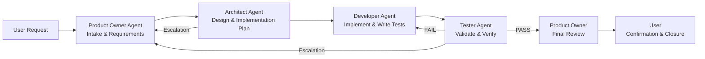

# AGENTS.md — TimeSheetAlgo

## Table of Contents
- [Quick Setup](#quick-setup-critical-for-ramping-up)
- [Testing Strategy](#testing-strategy)
- [Architecture & Configuration](#architecture--configuration)
- [Environment Detection Rules](#environment-detection-rules)
- [Git & PR Conventions](#git--pr-conventions)
- [Agent Development Modes](#agent-development-modes)
- [Agent Development Workflow](#agent-development-workflow)
- [CI Pipeline Details](#ci-pipeline-details)
- [File System & Working Directory](#file-system--working-directory)
- [Test Fixtures & Structure](#test-fixtures--structure)
- [Runtime Behavior](#runtime-behavior)
- [Build & Release](#build--release)
- [Key Gotchas Agents Miss](#key-gotchas-agents-miss)
- [Documentation Reference](#documentation-reference)

## Quick Setup (Critical for Ramping Up)

**Install development environment:**
```bash
# Always install in development mode with dev extras
python -m pip install -e .[dev]
```

**Virtual environment activation (non-negotiable):**
```bash
# Git checkout always requires this
git checkout <branch-name>
source /workspaces/TimeSheet/.venv/bin/activate
echo "✅ venv activated: $VIRTUAL_ENV"  # Must show /.venv path
```

## Testing Strategy

**Run different test suites:**
```bash
# Full test suite with coverage (CI requirement)
python -m pytest tests/ --cov=src_timesheetalgo --cov-report=term-missing

# Fast CI mode (what actual PRs run)
python -m pytest -m "not system"

# Individual levels
python -m pytest tests/unit -m unit          # Unit tests only
python -m pytest tests/integration -m integration  # Integration tests only
python -m pytest tests/system -m system      # System tests (real files required)
```

**Code quality checks (gates PRs):**
```bash
# Order matters - run in sequence
ruff check src_timesheetalgo tests
black --check src_timesheetalgo tests
pydocstyle src_timesheetalgo tests
radon cc src_timesheetalgo -a

# Traceability - CI gate, exits non-zero if incomplete
python .github/scripts/generate_traceability_matrix.py
```

## Architecture & Configuration

**Package structure:**
- `src_timesheetalgo/` - Main package (tested, covered)
  - `TimeSheetAlgo.py` - Entrypoint application
  - `config.yaml` - Configuration file
- `src_azesheetalgo/` - Separate package (AZE sheet functionality, NOT packaged, NOT tested)

**Critical config requirements:**
- Year is **required** at root level in `config.yaml` - no fallback
- Environment auto-detected by folder structure, not config parameter
- Paths are **relative to project root**, not script location

## Environment Detection Rules

**Environment detection logic:**
- Development: Running from `src_timesheetalgo/` directory
- Production: Contains `Timealarm/` subfolder in path
- Fallback: Always development

**Configuration auto-detection:**
```python
# From TimeSheetAlgo.py:96-110
def detect_environment(base_path: str) -> str:
    if os.path.basename(base_path) == "src_timesheetalgo":
        return "development"
    elif os.path.isdir(os.path.join(base_path, "Timealarm")):
        return "production"
    else:
        return "development"
```

## Git & PR Conventions

**Branch strategy:**
- Feature branches: `feature/PRO-123-description` (direct pushes allowed)
- PRs always target `master`
- Release branches: `release/vX.Y.Z` (protected, PR required)

**Naming validation (CI blockers):**
- **Commit messages:** `type(scope): description` + `Refs: PRO-XXX` footer
- **PR title:** `[type][PRO-XXX] Description`
- **PR body:** Must contain `## Summary` + `## Testing` + `Refs: PRO-XXX`

**No tests on direct branch pushes:**
- CI only runs on PRs to `master` or `release/**`
- CI also runs on release tags
- Feature branch commits are not tested

**Closure policy:**
- Remote branch deletion is User / PO responsibility — agent prepares command, user confirms and executes
- Agent-team closure executes `atlassian_transitionJiraIssue` and `gh pr merge` only after user / PO confirmation
- **Implementation plan deletion:** After a feature is fully completed (PR merged to master, JIRA ticket transitioned to Fertig), the implementation plan document (`doc/02_Implementation_Plan_PRO-XXX.md`) must be deleted. The plan is a working document that becomes stale once the feature is complete and merged. Deletion is part of the finalization commit/push.

## Agent Development Modes

**Mode selection (set before starting a feature):**
- `interactive` — pause at every handover for user confirmation before the next agent takes over
- `automated` — run the full pipeline without user pauses; only blockers and cycle limits interrupt

**Mode detection from chat:**
The Product Owner agent parses user chat messages for conversational patterns to derive the mode and persists it in `.opencode/pipeline-state.json`:

```bash
python .opencode/scripts/detect_mode.py PRO-373 "Run in automated"
python .opencode/scripts/detect_mode.py PRO-373 --show
```

- "Run in automated", "go ahead", "proceed", "without confirmation" → `development_mode: automated`
- "Run in interactive", "pause", "confirm", "ask me" → `development_mode: interactive`
- Default is `interactive` when no mode is detected

**Pipeline state:**
State is persisted per ticket in `.opencode/pipeline-state.json` (encrypted if enabled). The `development_mode` field is read before every dispatch and handoff so all 4 agents respect the user's mode choice.

**Enhanced Pipeline Management:**
The `pipeline.py` script provides enhanced pipeline management for handling
interrupted pipelines, resuming stuck steps, and inspecting state. All commands
are invoked from the repository root:

```bash
python .opencode/scripts/pipeline.py <command> <ticket> [options]
```

| Command | Purpose |
|---------|---------|
| `show state PRO-373` | Show current pipeline state with interruption detection |
| `what-missed PRO-373` | Show what work was missed in an interrupted pipeline |
| `check-stuck PRO-373` | Detect and alert on stuck pipelines |
| `dry-run PRO-373 <action>` | Preview action without executing |
| `resume PRO-373` | Resume pipeline at current step (clears interruption flag) |
| `resume PRO-373 --force` | Force resume without validation |
| `continue PRO-373` | Advance to next pipeline step |
| `continue PRO-373 --force` | Force advance without validation |
| `proceed PRO-373` | Proceed with current step execution |
| `history PRO-373` | Show pipeline history |
| `reset PRO-373` | Reset all cycles and state |
| `set-mode PRO-373 interactive` | Set development mode |
| `get-mode PRO-373` | Show persisted mode |

**Interruption recovery workflow:**
```bash
# 1. Check what was missed
python .opencode/scripts/pipeline.py what-missed PRO-373

# 2. Check if pipeline is stuck
python .opencode/scripts/pipeline.py check-stuck PRO-373

# 3. Preview the resume action
python .opencode/scripts/pipeline.py dry-run PRO-373 resume

# 4. Resume the pipeline
python .opencode/scripts/pipeline.py resume PRO-373

# 5. Verify state
python .opencode/scripts/pipeline.py show state PRO-373
```

**Pipeline state file location:**
- State: `.opencode/pipeline-state.json`
- History: `.opencode/pipeline-history.json`

### Agent Development Workflow



The Product Owner orchestrates the entire pipeline:

```
User → PO (intake) → [Architect → Developer → Tester] → PO (review) → User
```

- In **interactive** mode, the PO pauses for user confirmation before each handoff.
- In **automated** mode, the PO proceeds without pauses; only blockers and cycle limits interrupt.

### Documentation Reference

This file is the top-level guide for the TimeSheetAlgo agent development setup. It is organized top-down:

1. **[AGENTS.md](AGENTS.md)** - This file: project conventions, quick setup, testing, and agent development modes.
2. **[doc/AGENTS_WORKFLOW.md](doc/AGENTS_WORKFLOW.md)** - Detailed agent team workflow, handoff rules, quality gates, and Mermaid diagrams.
3. **[.opencode/agents/](.opencode/agents/)** - Operational agent definitions (`product-owner.agent.md`, `architect.agent.md`, `developer.agent.md`, `tester.agent.md`).
4. **[.opencode/scripts/](.opencode/scripts/)** - Pipeline automation scripts (`detect_mode.py`, `pipeline.py`).
5. **[.opencode/skills/](.opencode/skills/)** - Workflow reference documents (`plan-feature`, `develop-feature`, `complete-feature`, `orchestrate-feature`, `release-project`).

- `.opencode/agents/` files are discovered and executed by opencode.
- `.opencode/scripts/` are invoked from the repository root.
- `.opencode/skills/` are loaded by agents via YAML frontmatter `skills:` entries.

## CI Pipeline Details

**Job structure:**
- `check`: Linting + naming validation (runs first)
- `test`: Full test suite (runs in parallel with `check`)
- `publish`: Quality gate summary + PR comments

**Critical CI gates:**
1. Naming validation blocks merge entirely
2. Traceability script exits non-zero if requirements untraced
3. Coverage must be ≥90% (combined unit + integration + system)

**CI self-tests (.github/tests/):**
- Run in CI but not in local test suite
- `ci-pipeline/`: Workflow + script tests
- `agents/`: Agent orchestration tests (validates `.opencode/agents/` and `.opencode/skills/`)
- Must pass before committing `.github/` changes

## File System & Working Directory

**Working directory requirement:**
- **All paths relative to project root** (`/workspaces/TimeSheet`)
- Scripts expect to be run from repository root
- Configuration loading fails if not in root

**System test real files (committed but skipped when missing):**
- `sup/2025_extract.csv` - 93 sample timelog entries
- `src_timesheetalgo/2026_FDTech_Dennis_Hartel.xlsm` - 12-month workbook

**File locking:**
- Excel files can be locked by other processes
- Application warns but continues if file locked
- Requires closing Excel file manually if needed

## Test Fixtures & Structure

**Key fixtures (tests/conftest.py):**
- `frozen_time` - auto-frozen to "2025-12-23" for deterministic dates
- `mock_workbook` - Creates dummy 12-sheet workbook
- `mock_processor` - Processor with mock files already loaded
- `real_resource_copy` - Copies from `sup/` and `src_timesheetalgo/` or `None`

**Test markers:**
- `unit` - Individual functions/methods in isolation
- `integration` - `TimeSheetProcessor` pipeline on in-memory workbook
- `system` - Real-file copies + CLI flow (skipped when resources absent)

## Runtime Behavior

**Error handling patterns:**
- Configuration errors raise `ConfigError` with descriptive messages
- File I/O errors log warnings and continue when possible
- Year mismatch raises `ConsistencyError` with clear message
- Invalid dates logged as warnings with retry counts

**User input handling:**
- Uses dependency injection for `input_provider` and `clock`
- Tests inject deterministic providers to avoid mocking `builtins.input`
- Date parsing with retry logic (MAX_RETRIES = 3)

## Build & Release

**Build system:**
- Uses `setuptools` with `pyproject.toml`
- Entry points defined in `[tool.setuptools.packages.find]`

**Package structure:**
- Primary application in `src_timesheetalgo/`
- Separate tools in `src_azesheetalgo/`
- Tests in `tests/` with level subdirectories

## Key Gotchas Agents Miss

1. **Virtual environment is `.venv/` not `venv/`** - Must use exact name
2. **System tests skip when real files missing** - Not test failures
3. **Environment auto-detection** - Based on folder structure, not config
4. **No CI on direct branch pushes** - Only on PRs to master/release
5. **Working directory matters** - All paths relative to project root
6. **Traceability is CI gate** - Script exits non-zero if requirements untraced
7. **Coverage ≥90%** - Combined across all test levels
8. **Freeze time for tests** - Uses `freezegun` frozen to 2025-12-23
9. **Dependency injection** - Tests inject `input_provider` and `clock`
10. **Git checkout requires venv reactivation** - Non-negotiable for config

**Debug tip:** When tests fail, run `echo "venv: $VIRTUAL_ENV"` to confirm environment activation.