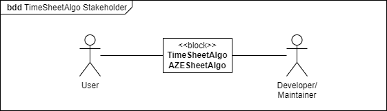
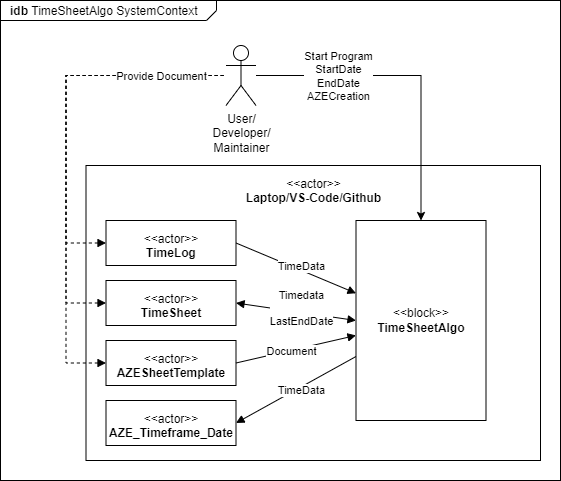
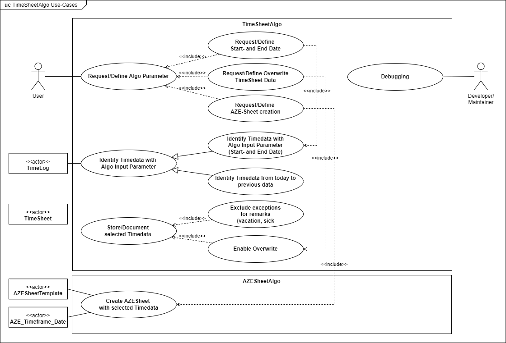
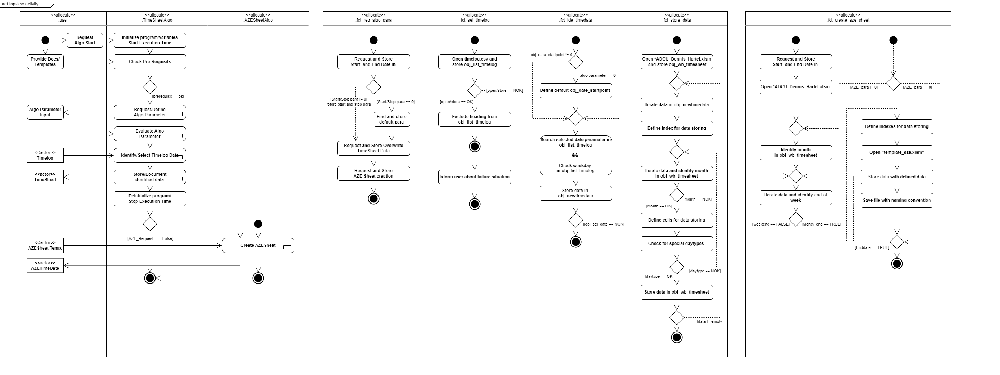

# TimeSheetAlgo

## Description
The TimeSheetAlgo is inteded to automate the manual timedata extraction, timedata documentation and AZESheet creation.

## Release naming convention
    <mandatory: Rxx.yy.zz> increment the:
    - xx: MAJOR version when you make incompatible API changes
    - yy: MINOR version when you add functionality in a backward compatible manner
    - zz: PATCH version when you make backward compatible bug fixes

    Example: R02.01.02

## Branch naming convention
   Release Branch 
    <mandatory: RCxx.yy.zz>
        - RC: Release Candidate
        - xx.yy.zz: Release Naming convention

        Example: RC02.01.02
    
    Feature Branch 
    <mandatory: Function/Infrastructure Change>|<mandatory: description>
        - FCT: Function Change Types
        - INF: Infrastructure Change Types

        Example: INF|Documentation

## Commit naming convention
    <mandatory: Branch Change Type>_<mandatory: change_type>|<optional: file></><mandatory: change/feature/description>
        - FCT: Function Change Types
            - A: Architecture Change
            - I: Interface Change
            - F: Functional Change
            - V: Variable Change
            - O: Optimazation Change
        - INF: Infrastructure Change Types
            - D: Documentation Change
            - R: Renaming Change
            - L: Location Change

        Example: INF_F|README.md/Split Commit and Branch Template

## Variable naming convention
    <mandatory: type>_<optional: unit><mandatory: variable_name> - e.g. str_date_startpoint

        type    |    description
        ---------------------------
        fil     |   file
        obj     |   complex datatype
        str     |   string
        int     |   integer
        db      |   double       
        bo      |   boolean

## Algo Analysis

### Stakeholder Analysis

### Stakeholder Analysis

### Use-Cases

### Activity Diagram

