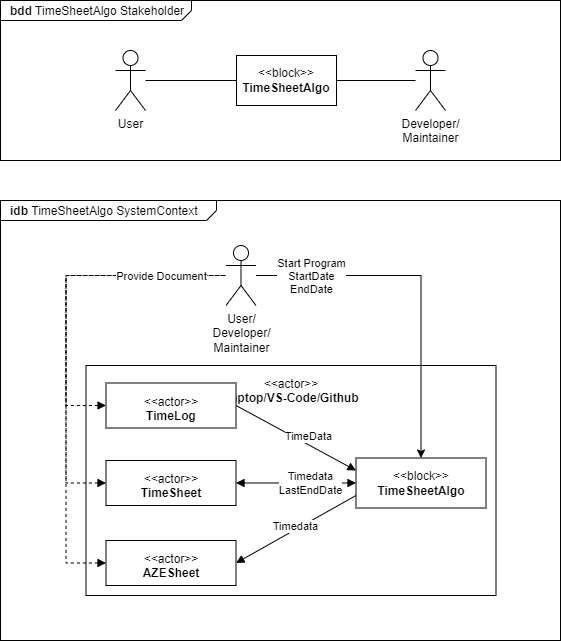

### TimeSheetAlgo

# Description
tbd

## Algo Analysis

# Context

# Use-Cases

## Architecture
tbd
- Activity Diagram
- Structural Diagram

# Variable Definition
    Variable declaration naming convention
    <mandatory: type>_<optional: unit><mandatory: variable_name> - e.g. str_date_startpoint

        type    |    description
        ---------------------------
        obj     |   complex datatype
        str     |   string
        int     |   integer
        db      |   double       
        bo      |   boolean

CHANGES :
    REF NO  VERSION DATE    WHO     DETAIL
            A.00.01 220126  DH      Function CalcHuffman corrected

# Branch Template
    Branch change template naming convention
    <mandatory: Function/Infrastructure Change>|<mandatory: description>
        - FCT: Function Change Types
        - INF: Infrastructure Change Types

        Example: INF|Documentation

# Commit Template
    Commit change template naming convention
    <mandatory: Branch Change Type>_<mandatory: change_type>|<mandatory: file/feature/description>
        - FCT: Function Change Types
            - A: Architecture Change
            - I: Interface Change
            - F: Functional Change
            - V: Variable Change
            - O: Optimazation Change
        - INF: Infrastructure Change Types
            - D: Documentation Change
            - R: Renaming Change
            - L: Location Change

        Example: INF_F|README.md/Split Commit and Branch Template
