# TimeSheet Architecture

TimeSheet is a single-module Python CLI (`src_timesheetalgo/TimeSheetAlgo.py`)
that reads a CSV timelog, asks the user for a date range, writes the matching
start/end times into the correct month worksheet of an Excel `.xlsm` timesheet,
and saves it. Configuration is YAML-driven with folder-based environment
detection; there is no database or network dependency.

This document covers the system context, the runtime processing pipeline, the
data model, and the configuration subsystem.

Testing details, including the suite layout and the traceability validation workflow, are documented in [doc/TESTING.md](TESTING.md).

## Traceability Approach

The repository uses lightweight requirement identifiers in the form FR-XX and QR-XX. These IDs are used in [doc/REQUIREMENTS.md](REQUIREMENTS.md), the implementation in [src_timesheetalgo/TimeSheetAlgo.py](../src_timesheetalgo/TimeSheetAlgo.py), and the traceability entries below so that design, code, and tests remain aligned.

## Traceability Matrix

| Requirement ID | Architectural concern | Implementation reference |
| --- | --- | --- |
| FR-01 | Configuration loading | [src_timesheetalgo/TimeSheetAlgo.py](../src_timesheetalgo/TimeSheetAlgo.py) - `load_config()` and `configure_logging()` |
| FR-02 | Environment detection | [src_timesheetalgo/TimeSheetAlgo.py](../src_timesheetalgo/TimeSheetAlgo.py) - `detect_environment()` |
| FR-03 | Configuration validation | [src_timesheetalgo/TimeSheetAlgo.py](../src_timesheetalgo/TimeSheetAlgo.py) - `_read_yaml()` and `load_config()` |
| FR-04 | Input file loading | [src_timesheetalgo/TimeSheetAlgo.py](../src_timesheetalgo/TimeSheetAlgo.py) - `load_files()` and `check_file_existence()` |
| FR-05 | Input file validation | [src_timesheetalgo/TimeSheetAlgo.py](../src_timesheetalgo/TimeSheetAlgo.py) - `check_file_existence()`, `validate_timelog_entry()`, `validate_timesheet_structure()` |
| FR-06 | Timesheet consistency check | [src_timesheetalgo/TimeSheetAlgo.py](../src_timesheetalgo/TimeSheetAlgo.py) - `check_year_consistency()` |
| FR-07 | Date range determination | [src_timesheetalgo/TimeSheetAlgo.py](../src_timesheetalgo/TimeSheetAlgo.py) - `request_date_input()`, `parse_date()`, `set_default_start_date()`, `set_default_end_date()`, `calculate_default_start_date()` |
| FR-08 | Timelog filtering | [src_timesheetalgo/TimeSheetAlgo.py](../src_timesheetalgo/TimeSheetAlgo.py) - `select_timelog_data()`, `filter_timelog_entries()` |
| FR-09 | Mapping logic | [src_timesheetalgo/TimeSheetAlgo.py](../src_timesheetalgo/TimeSheetAlgo.py) - `store_data()`, `map_entry_to_cell()` |
| FR-10 | Existing data detection | [src_timesheetalgo/TimeSheetAlgo.py](../src_timesheetalgo/TimeSheetAlgo.py) - `_check_and_confirm_overwrite()` |
| FR-11 | Overwrite decision | [src_timesheetalgo/TimeSheetAlgo.py](../src_timesheetalgo/TimeSheetAlgo.py) - `_prompt_overwrite_decision()` |
| FR-12 | Data transfer | [src_timesheetalgo/TimeSheetAlgo.py](../src_timesheetalgo/TimeSheetAlgo.py) - `store_data()` (returns `StoreResult`) |
| FR-13 | Saving | [src_timesheetalgo/TimeSheetAlgo.py](../src_timesheetalgo/TimeSheetAlgo.py) - `save_timesheet()` |
| FR-14 | Error handling | [src_timesheetalgo/TimeSheetAlgo.py](../src_timesheetalgo/TimeSheetAlgo.py) - `run()` |
| FR-15 | Logging | [src_timesheetalgo/TimeSheetAlgo.py](../src_timesheetalgo/TimeSheetAlgo.py) - `configure_logging()` and `run()` |
| QR-01 | Reliability | [src_timesheetalgo/TimeSheetAlgo.py](../src_timesheetalgo/TimeSheetAlgo.py) - `check_year_consistency()` and `run()` |
| QR-02 | Data integrity | [src_timesheetalgo/TimeSheetAlgo.py](../src_timesheetalgo/TimeSheetAlgo.py) - `select_timelog_data()`, `filter_timelog_entries()` and `store_data()` |
| QR-03 | Consistency | [src_timesheetalgo/TimeSheetAlgo.py](../src_timesheetalgo/TimeSheetAlgo.py) - `check_year_consistency()` |
| QR-04 | Usability | [src_timesheetalgo/TimeSheetAlgo.py](../src_timesheetalgo/TimeSheetAlgo.py) - `request_date_input()`, `TimeSheetProcessor.for_testing()` |
| QR-05 | Robustness | [src_timesheetalgo/TimeSheetAlgo.py](../src_timesheetalgo/TimeSheetAlgo.py) - `check_file_existence()`, `parse_date()`, `validate_timelog_entry()`, `validate_timesheet_structure()` |
| QR-06 | Maintainability | [src_timesheetalgo/TimeSheetAlgo.py](../src_timesheetalgo/TimeSheetAlgo.py) - `load_config()` and `configure_logging()` |
| QR-07 | Traceability | [src_timesheetalgo/TimeSheetAlgo.py](../src_timesheetalgo/TimeSheetAlgo.py) - this module and the traceability comments in each function |
| FR-16 | CI dependency caching | [python-ci.yml](../.github/workflows/python-ci.yml) - `actions/setup-python` `cache: pip` / `cache-dependency-path: pyproject.toml` in check, test and deploy jobs |
| FR-17 | CI reusable environment setup | [setup-python-deps/action.yml](../.github/actions/setup-python-deps/action.yml) - composite action used by check, test and deploy jobs |
| QR-08 | CI performance | [python-ci.yml](../.github/workflows/python-ci.yml) - pip download caching (keyed on `pyproject.toml`), removed `actions/setup-node`, single reusable composite action (no duplicated setup) |
| QR-09 | CI maintainability | [setup-python-deps/action.yml](../.github/actions/setup-python-deps/action.yml) - single composite action for Python setup, pip caching and dependency install (each job runs `actions/checkout` before it) |

## CI Setup Design Decision: Composite Action vs. Inlined Steps (QR-08, QR-09)

The Python environment setup (checkout → `actions/setup-python` with pip cache →
`pip install -e .[dev]`) is shared by all three CI jobs (`check`, `test`,
`deploy`). Two designs were considered:

- **Composite action** (chosen): the setup steps live once in
  [setup-python-deps/action.yml](../.github/actions/setup-python-deps/action.yml)
  and each job calls it with `uses: ./.github/actions/setup-python-deps`.
- **Inlined steps**: the same steps copied into each job.

**Decision:** use the composite action, for maintainability (QR-09) — a single
source of truth for the environment, one place to change the Python version,
cache key, or install command, and consistent setup across jobs.

**Constraint discovered:** a local (`./`) composite action cannot perform the
repository checkout itself, because it can only be resolved *after* the repo is
on the runner. Each job therefore runs `actions/checkout` before the composite
action; the action owns Python setup, pip caching and dependency install only.

**Performance validated (not assumed).** To confirm the `uses:` indirection
carries no runtime cost, a dispatch-only benchmark
([benchmark.yml](../.github/workflows/benchmark.yml)) measures warm-cache setup
time for both designs (8 runs each, identical pip cache warmed beforehand). One
run on `ubuntu-latest`, Python 3.14:

| Variant | Runs | Mean (s) | Median (s) | Std dev (s) | Min (s) | Max (s) |
| --- | --- | --- | --- | --- | --- | --- |
| composite | 8 | 9.972 | 10.013 | 1.006 | 8.491 | 11.722 |
| inline | 8 | 11.171 | 9.919 | 2.990 | 9.246 | 18.103 |

Medians are effectively identical (10.01 s vs. 9.92 s); the inline mean is
skewed upward by a single 18.1 s outlier. The mean delta (-1.2 s, -10.7 %) is
well within the largest per-variant standard deviation (2.99 s), so the two
designs are **statistically equivalent** in runtime. The composite action is
therefore adopted for its maintainability benefit at no measurable performance
cost. The benchmark is retained (manual `workflow_dispatch` only, outside the CI
pipeline) so the comparison can be re-run when the toolchain changes.

## System-Level Diagrams

### Stakeholder Diagram

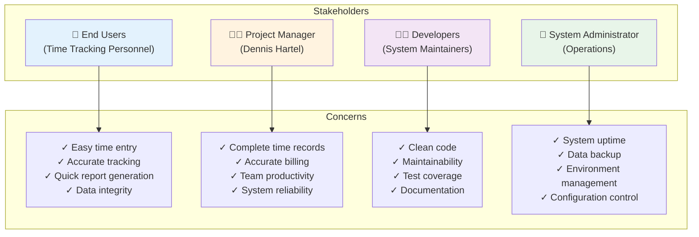

### System Context Diagram

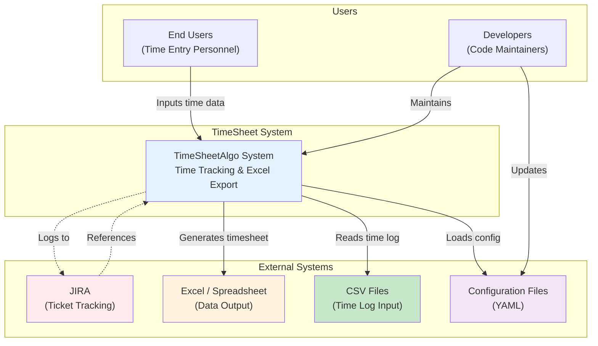

### Use Cases Diagram

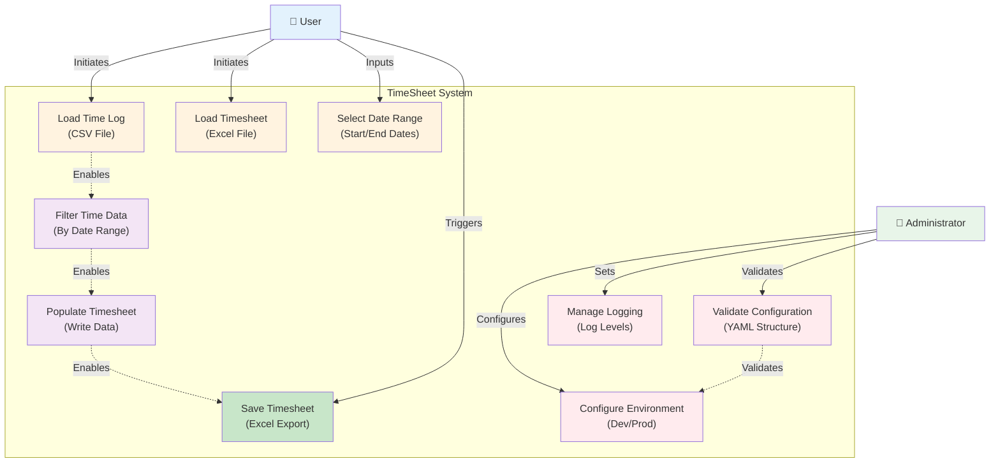

---

## Processing Pipeline

`main()` loads configuration and delegates to `run(config)`, which drives the
five-step pipeline on a `TimeSheetProcessor`. A failure in any step (for example
an empty selection) is logged and ends the run gracefully rather than crashing.

```mermaid
sequenceDiagram
    participant CLI as main()
    participant RUN as run(config)
    participant P as TimeSheetProcessor
    participant CSV as timelog.csv
    participant XLSM as timesheet.xlsm

    CLI->>CLI: load_config() + configure_logging()
    CLI->>RUN: run(config)
    RUN->>P: load_files()
    P->>CSV: read rows (skip header)
    P->>XLSM: load_workbook(keep_vba=True)
    RUN->>P: request_date_input()
    Note over P: prompt start/end (DD.MM.YYYY)<br/>otherwise defaults: start = last worked day,<br/>end = yesterday
    RUN->>P: select_timelog_data()
    Note over P: keep rows within (start, end);<br/>raise ValueError if none
    RUN->>P: store_data()
    Note over P: per entry → sheet[month-1],<br/>row ROW_OFFSET+day, cols E/F
    RUN->>P: save_timesheet()
    P->>XLSM: workbook.save()
```

### Overwrite Decision

When `store_data()` finds existing values in target cells it asks once how to
proceed; the answer drives a small state machine applied to every conflicting day.

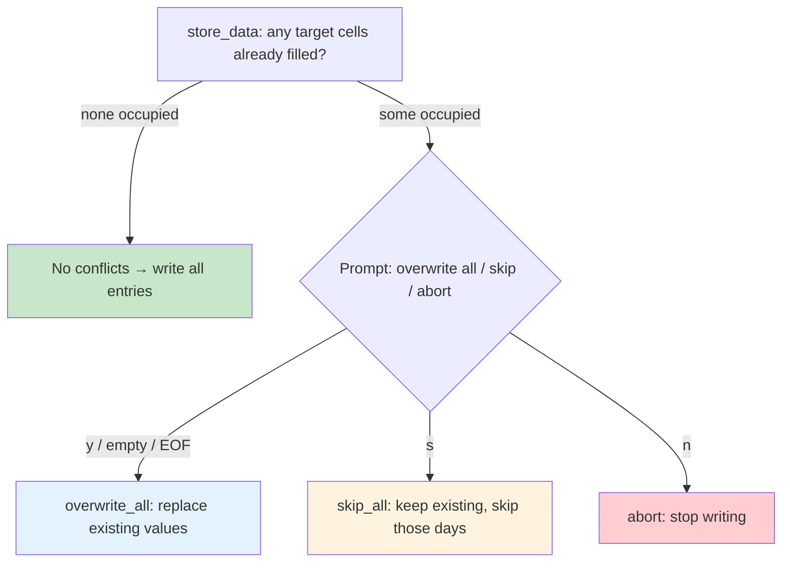

---

## Data Model

### Timelog (CSV input)

A header line followed by rows of `Date,Start,End,Remark`:

- `Date` — `DD.MM.YYYY`
- `Start`, `End` — `HH:MM` (or `HH:MM:SS`)
- `Remark` — free text, **not** written to the timesheet

### Timesheet (Excel `.xlsm`)

- 12 month worksheets; worksheet **index = `date.month - 1`** (January = 0 … December = 11).
- A day's entry lives at **row = `ROW_OFFSET + day`** (`ROW_OFFSET = 4`, so day 1 → row 5, day 31 → row 35).
- **Column 5 (E)** = start time, **Column 6 (F)** = end time.
- The work year comes from configuration (and the year cell at row 3, column 2 of the first sheet).
- Loaded with `keep_vba=True` so embedded macros survive a save.

### Constants (`TimeSheetAlgo.py`)

| Constant | Value | Meaning |
|----------|-------|---------|
| `DATE_FORMAT` | `%d.%m.%Y` | date parsing/format |
| `ROW_OFFSET` | `4` | header rows above day 1 |
| `TIMESHEET_SHEETS` | `12` | month worksheets |
| `MAX_RETRIES` | `3` | date-input retry budget |

---

## Configuration Subsystem

### System Architecture Overview

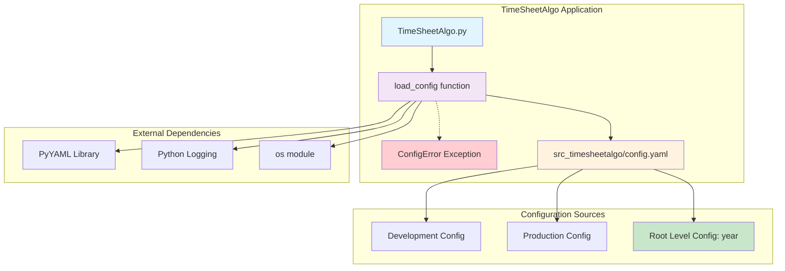

### Configuration Loading Flow

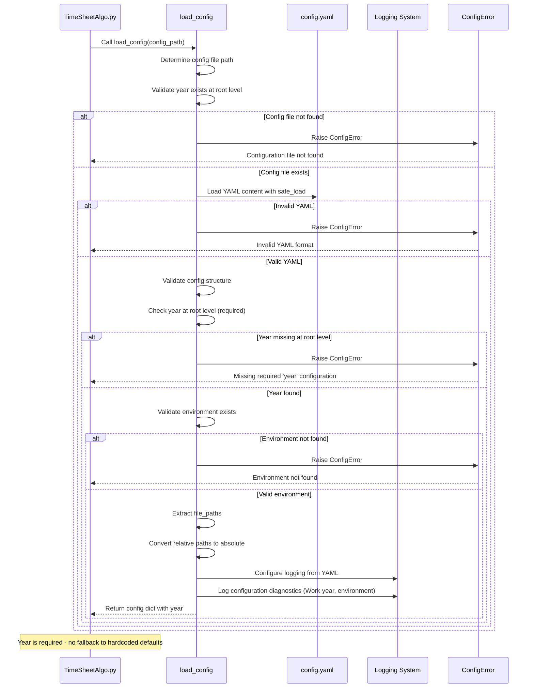

### Environment Selection Logic

The environment is detected purely from the **folder structure** by
`detect_environment(base_dir)` — there is no environment parameter, and the
`default_environment` key present in `config.yaml` is **not** read by the loader.

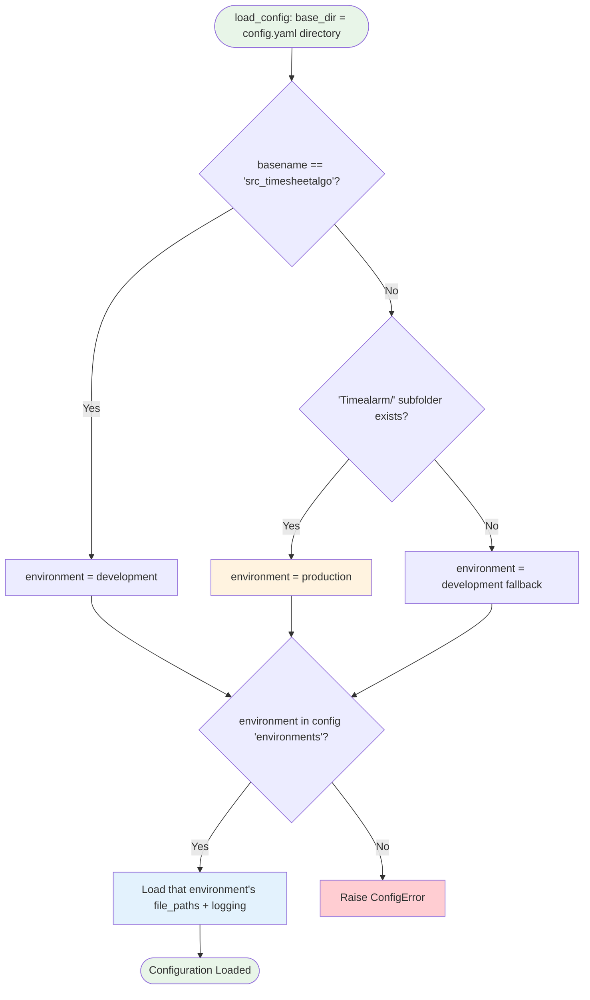

### Configuration Structure

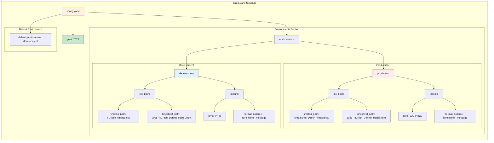

### Error Handling Flow

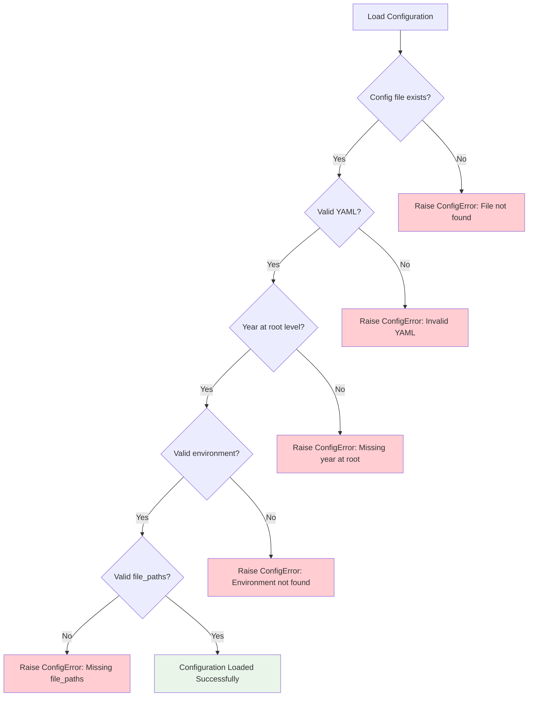

### Class Relationship Diagram

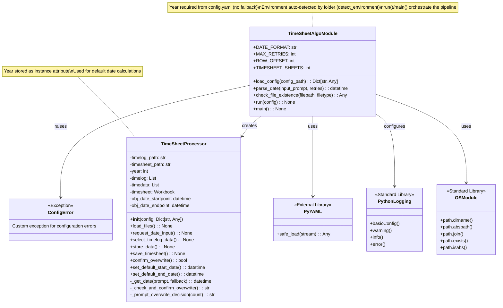

### Deployment Architecture

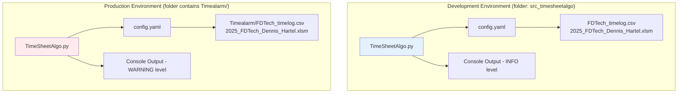

> The end-to-end validation order is shown in **Error Handling Flow** above
> (file → YAML → year → environment → file_paths). There is **no** fallback to
> hardcoded defaults: any `ConfigError` propagates to `main()`, which logs it and
> exits with status 1.

---
