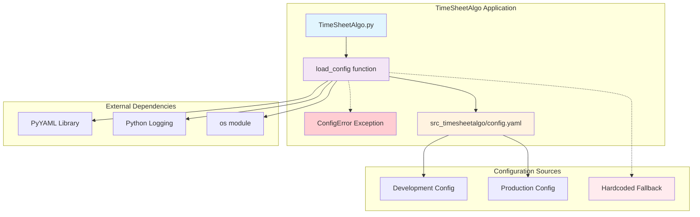
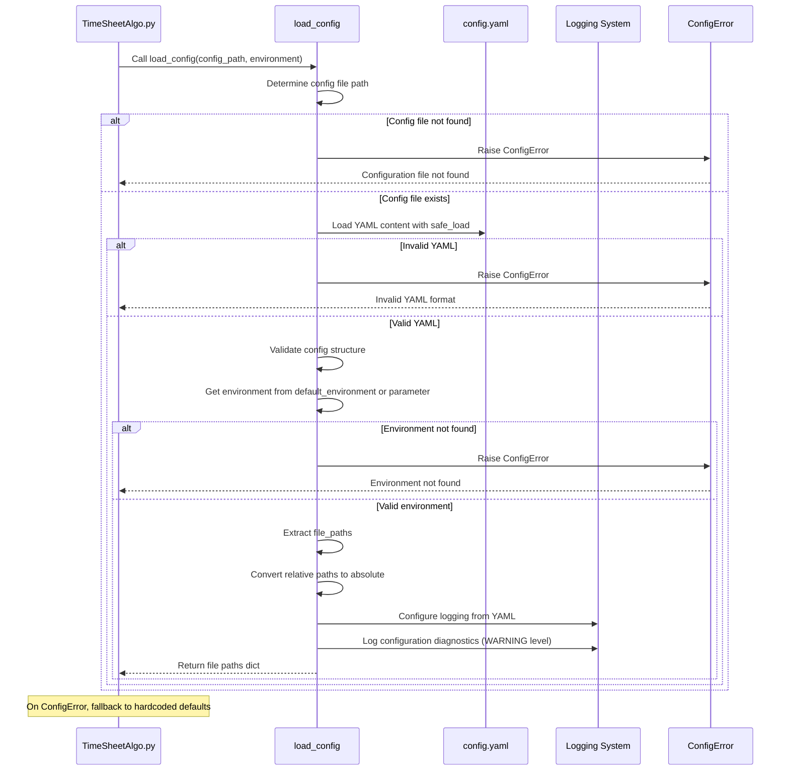
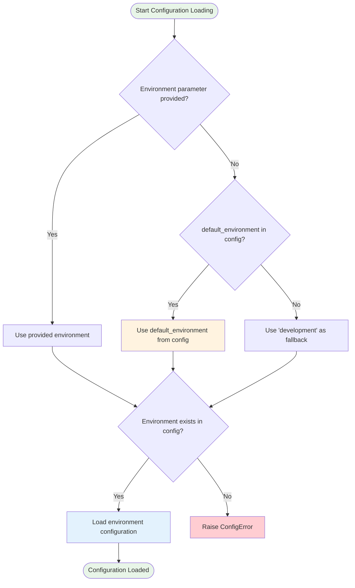
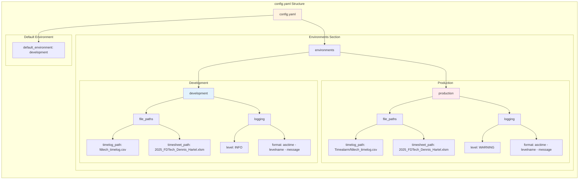
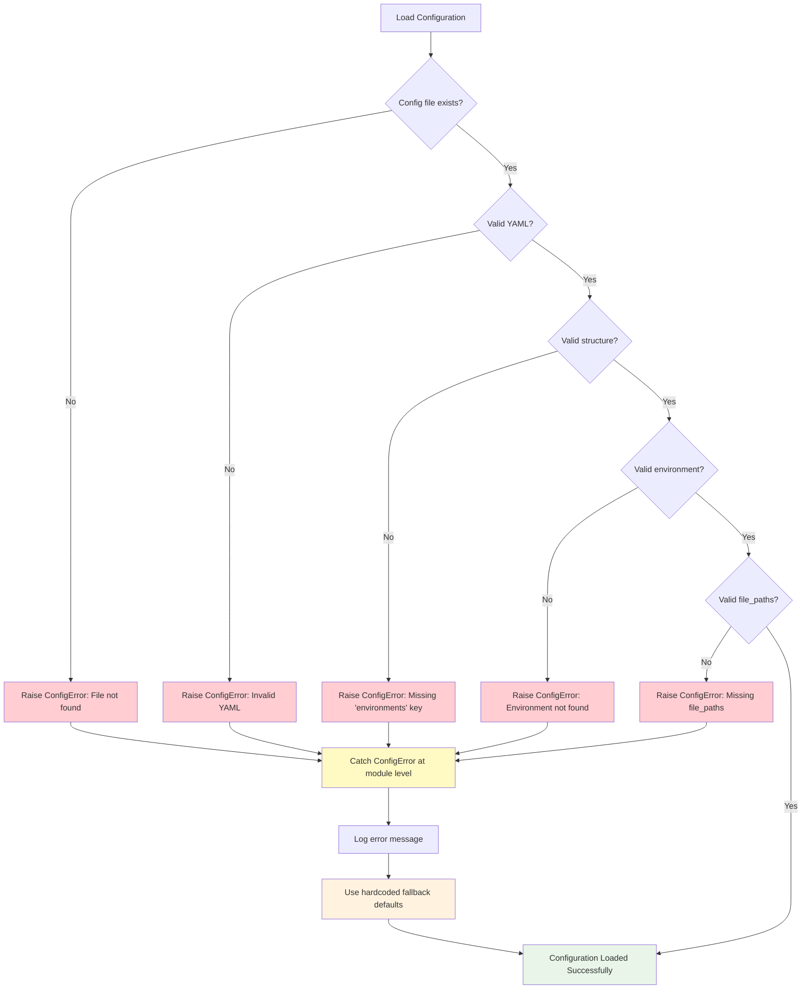
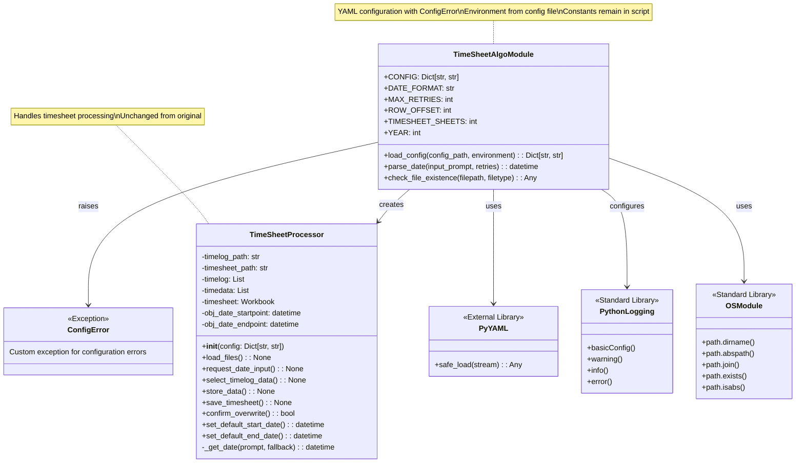
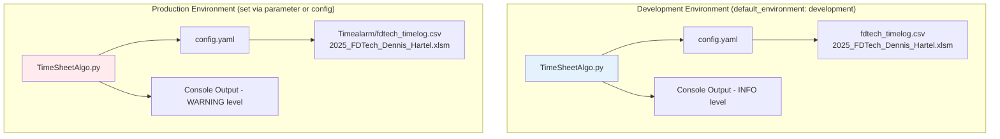

# YAML Configuration System Architecture Diagrams

## System Architecture Overview



## Configuration Loading Flow



## Environment Selection Logic



## Configuration Structure



## Error Handling Flow



## Class Relationship Diagram



## Deployment Architecture



## Configuration Validation Process

```mermaid
stateDiagram-v2
    [*] --> LoadingConfig
    
    LoadingConfig --> FileCheck
    FileCheck --> FileExists : file found
    FileCheck --> RaiseConfigError : file not found
    
    FileExists --> YAMLParsing
    YAMLParsing --> ValidYAML : parsing successful
    YAMLParsing --> RaiseConfigError : parsing failed
    
    ValidYAML --> StructureValidation
    StructureValidation --> ValidStructure : has 'environments' key
    StructureValidation --> RaiseConfigError : missing required keys
    
    ValidStructure --> EnvironmentSelection
    EnvironmentSelection --> ValidEnvironment : environment found
    EnvironmentSelection --> RaiseConfigError : environment not found
    
    ValidEnvironment --> PathValidation
    PathValidation --> ValidPaths : has required paths
    PathValidation --> RaiseConfigError : missing paths
    
    ValidPaths --> PathConversion
    PathConversion --> ConfigurationReady
    
    RaiseConfigError --> CatchException
    CatchException --> FallbackDefaults
    FallbackDefaults --> ConfigurationReady
    
    ConfigurationReady --> [*]
    
    note right of ConfigurationReady : Configuration loaded successfully\nLogging configured from YAML\nFile paths converted to absolute\nDiagnostics logged at WARNING level
    
    note right of FallbackDefaults : Using hardcoded defaults\nError logged\nGraceful degradation