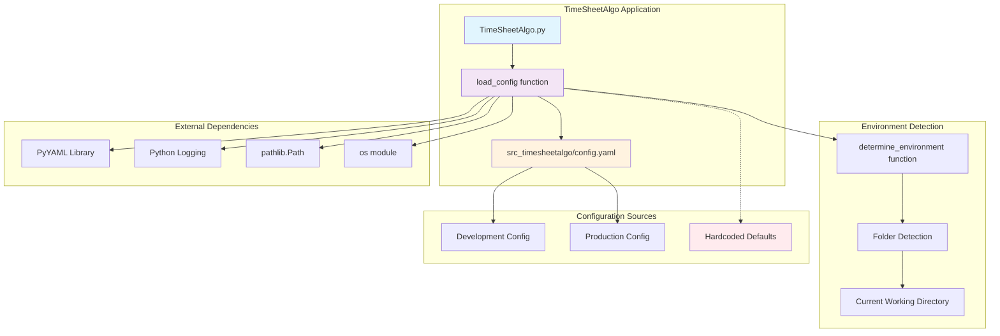
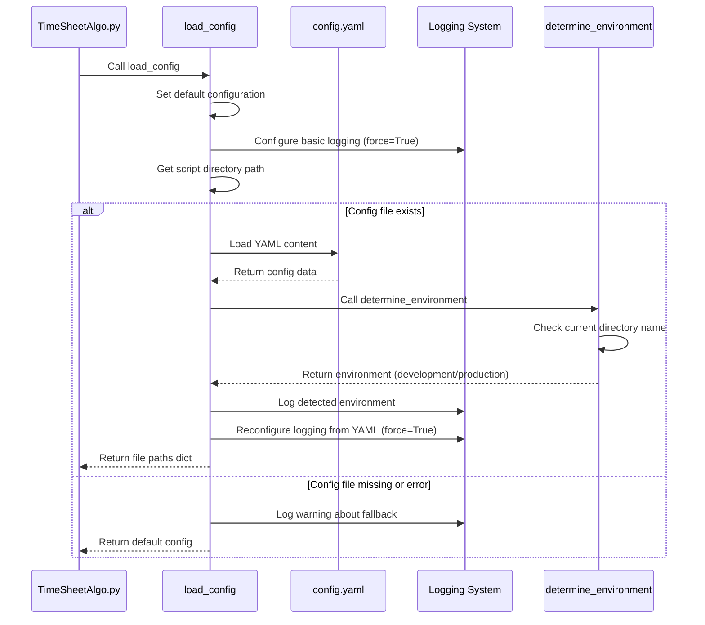
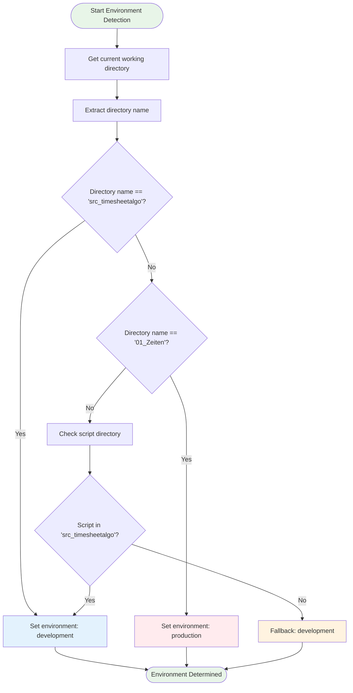
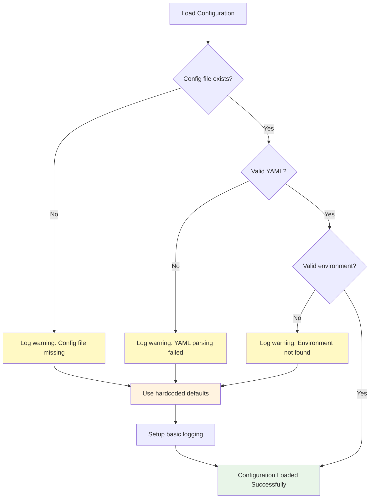
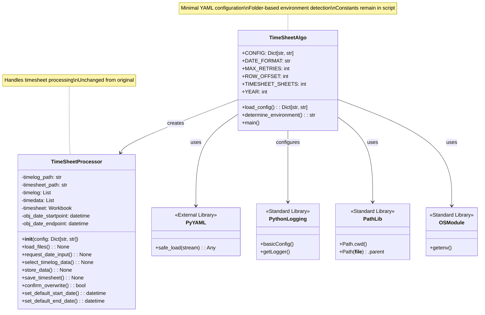

# YAML Configuration System Architecture Diagrams

## System Architecture Overview



## Configuration Loading Flow



## Environment Detection Logic



## Configuration Structure

```mermaid
graph LR
    subgraph "config.yaml Structure"
        ROOT[config.yaml]
        
        subgraph "Default Environment"
            DEFAULT[default_environment: development]
        end
        
        subgraph "Environments Section"
            ENVS[environments]
            
            subgraph "Development"
                DEV_ENV[development]
                DEV_PATHS[file_paths]
                DEV_LOG[logging]
                DEV_TL[timelog_path: FDTech_timelog.csv]
                DEV_TS[timesheet_path: 2025_FDTech_Dennis_Hartel.xlsm]
                DEV_LVL[level: INFO]
                DEV_FMT[format: %(asctime)s - %(levelname)s - %(message)s]
            end
            
            subgraph "Production"
                PROD_ENV[production]
                PROD_PATHS[file_paths]
                PROD_LOG[logging]
                PROD_TL[timelog_path: /data/timelog/FDTech_timelog.csv]
                PROD_TS[timesheet_path: /data/timesheet/2025_FDTech_Dennis_Hartel.xlsm]
                PROD_LVL[level: WARNING]
                PROD_FMT[format: %(asctime)s - %(levelname)s - %(message)s]
            end
        end
    end
    
    ROOT --> DEFAULT
    ROOT --> ENVS
    
    ENVS --> DEV_ENV
    ENVS --> PROD_ENV
    
    DEV_ENV --> DEV_PATHS
    DEV_ENV --> DEV_LOG
    DEV_PATHS --> DEV_TL
    DEV_PATHS --> DEV_TS
    DEV_LOG --> DEV_LVL
    DEV_LOG --> DEV_FMT
    
    PROD_ENV --> PROD_PATHS
    PROD_ENV --> PROD_LOG
    PROD_PATHS --> PROD_TL
    PROD_PATHS --> PROD_TS
    PROD_LOG --> PROD_LVL
    PROD_LOG --> PROD_FMT
    
    style ROOT fill:#fff3e0
    style DEV_ENV fill:#e3f2fd
    style PROD_ENV fill:#ffebee
```

## Error Handling Flow



## Class Relationship Diagram



## Deployment Architecture

```mermaid
graph TB
    subgraph "Development Environment (src_timesheetalgo folder)"
        DEV_SCRIPT[TimeSheetAlgo.py]
        DEV_CONFIG[config.yaml]
        DEV_DATA[FDTech_timelog.csv<br/>2025_FDTech_Dennis_Hartel.xlsm]
        DEV_LOGS[Console Output - INFO level]
    end
    
    subgraph "Production Environment (01_Zeiten folder)"
        PROD_SCRIPT[TimeSheetAlgo.py]
        PROD_CONFIG[config.yaml]
        PROD_DATA[/data/timelog/FDTech_timelog.csv<br/>/data/timesheet/2025_FDTech_Dennis_Hartel.xlsm]
        PROD_LOGS[Console Output - WARNING level]
    end
    
    DEV_SCRIPT --> DEV_CONFIG
    DEV_CONFIG --> DEV_DATA
    DEV_SCRIPT --> DEV_LOGS
    
    PROD_SCRIPT --> PROD_CONFIG
    PROD_CONFIG --> PROD_DATA
    PROD_SCRIPT --> PROD_LOGS
    
    style DEV_SCRIPT fill:#e3f2fd
    style PROD_SCRIPT fill:#ffebee
    
    note for DEV_SCRIPT "Folder-based detection:<br/>src_timesheetalgo → development"
    note for PROD_SCRIPT "Folder-based detection:<br/>01_Zeiten → production"
```

## Configuration Validation Process

```mermaid
stateDiagram-v2
    [*] --> LoadingConfig
    
    LoadingConfig --> FileCheck
    FileCheck --> FileExists : file found
    FileCheck --> MissingFile : file not found
    
    FileExists --> YAMLParsing
    YAMLParsing --> ValidYAML : parsing successful
    YAMLParsing --> InvalidYAML : parsing failed
    
    ValidYAML --> EnvironmentDetection
    EnvironmentDetection --> ValidEnvironment : environment found
    EnvironmentDetection --> InvalidEnvironment : environment not found
    
    ValidEnvironment --> ConfigurationReady
    
    MissingFile --> FallbackDefaults
    InvalidYAML --> FallbackDefaults
    InvalidEnvironment --> FallbackDefaults
    
    FallbackDefaults --> ConfigurationReady
    ConfigurationReady --> [*]
    
    note right of ConfigurationReady : Configuration loaded successfully\nLogging configured\nFile paths available\nEnvironment detected from folder
    
    note right of FallbackDefaults : Using hardcoded defaults\nBasic logging setup\nWarning logged\nGraceful degradation